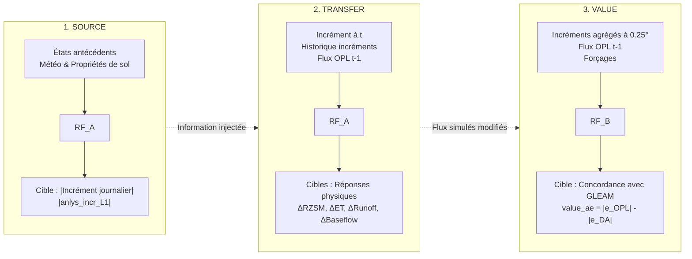

# SMAP-XAI Audit : Cadre d'Audit et d'Explicabilité Scientifique de l'Assimilation SMAP

**Auteur :** M. El Aabaribaoune (@um6p)
**Branche active :** `elaabar`
**Environnement cible :** Linux / SLURM HPC (H-CEL / UM6P)

---

## 1. Contexte scientifique et géographique

Ce projet étudie l'impact de l'assimilation de données d'humidité du sol satellitaires **SMAP** (*Soil Moisture Active Passive*, radiomètre bande L, 0–5 cm) dans le modèle de surface continentale **Noah-MP** (*Noah Land Surface Model with Multi-Parameterization Options*), exécuté sous l'infrastructure **LIS** (*Land Information System*, NASA GSFC).

Le domaine d'étude couvre le **Nord du Maroc (domaine NorthMor)** :
- **Grille de calcul :** $121 \times 181$ mailles régulières à résolution $0{,}05^\circ$ ($\approx 5\text{ km}$), totalisant **16 030 pixels continentaux actifs** (bornes géographiques : $30^\circ\text{N}\text{--}36^\circ\text{N}$, $10^\circ\text{W}\text{--}1^\circ\text{W}$).
- **Période hydrologique :** 1er janvier 2016 au 31 décembre 2020 (5 années complètes couvrant des cycles humides et de fortes sécheresses méditerranéennes).
- **Enjeu scientifique :** En milieu semi-aride et méditerranéen, la dynamique hydrique est caractérisée par de forts contrastes saisonniers, une hétérogénéité orographique marquée (Rif, Moyen et Haut Atlas) et une forte limitation par l'eau. Comprendre comment l'assimilation satellitaire modifie les états du sol et les flux de surface est crucial pour la modélisation hydrologique et agronomique.

---

## 2. Problématique centrale et rôle du Machine Learning explicable (XAI)

L'assimilation de données par filtre de Kalman d'ensemble (EnKF) est classiquement évaluée de manière globale (scores statistiques moyens de type RMSE, corrélation sur l'ensemble du domaine). Cependant, cette approche globale présente d'importantes limites méthodologiques :
- Elle ne révèle pas **sous quelles conditions environnementales** le filtre intervient avec une forte amplitude.
- Elle n'explique pas **la manière dont la correction de surface est redistribuée** dans la colonne racinaire et modifie les flux couplés (évapotranspiration, ruissellement, drainage).
- Elle ne garantit pas que les ajustements apportés soient cohérents ou bénéfiques face à des références indépendantes.

L'objectif de `smap-xai-audit` est d'utiliser l'apprentissage automatique supervisé (Random Forest) couplé à la théorie des jeux coopératifs (**TreeSHAP**) non pas comme un outil de prévision opérationnelle, mais comme un **outil d'audit et d'attribution statistique** :
> **Précision épistémologique :** L'analyse SHAP quantifie l'attribution prédictive statistique au sein du modèle Random Forest ajusté. Elle n'identifie pas directement les mécanismes physiques régissant Noah-MP et ne constitue pas une démonstration de causalité physique.

---

## 3. Les trois expériences LIS / Noah-MP

L'audit repose sur l'examen rigoureux de trois simulations terrestres partageant rigoureusement le même domaine spatial, la même bathymétrie, les mêmes classes de sol/végétation et les mêmes forçages atmosphériques (ERA5-Land réanalysé) :

1. **OPL (*Open-Loop*) :** Simulation de contrôle continu sans aucune assimilation de données satellitaires. Elle constitue la trajectoire de référence intrinsèque du modèle.
2. **DA-NoCDF :** Simulation d'assimilation EnKF ingérant les observations SMAP brutes, sans redimensionnement préalable de la distribution d'humidité (*No CDF matching*). Ses performances et métriques d'apprentissage sur le test scellé 2020 sont formellement vérifiées et figées.
3. **DA-CDF (Corrigée) :** Simulation d'assimilation EnKF ingérant les observations SMAP après correction statistique par appariement de quantiles (*CDF matching*) recalculée sur la grille spatiale exacte NorthMor. Les prétraitements techniques (scripts 01–20) sont validés pour 2016–2020 ; les étapes ultérieures (datasets, entraînements ML, XAI) seront exécutées dans une phase dédiée.
   *(Note : les anciennes sorties DA-CDF antérieures au 27 octobre 2026 sont scientifiquement invalidées et formellement archivées, voir [`docs/invalidated_legacy_cdf_results.md`](docs/invalidated_legacy_cdf_results.md)).*

---

## 4. Logique méthodologique : Le cadre séquentiel SOURCE $\to$ TRANSFER $\to$ VALUE

Le cheminement de l'information satellitaire assimilée est structuré selon un **cadre d'investigation séquentiel** en trois approches :



> **Avertissement méthodologique :** Ce découpage en trois étapes constitue un protocole d'analyse pour tracer l'information d'assimilation du filtre vers les flux et vers l'évaluation externe. Il ne doit pas être qualifié de chaîne causale démontrée.

1. **SOURCE (Caractérisation de la correction d'analyse) :**
   *Question :* Quelles conditions d'humidité antécédente, de forçage météorologique et de texture de sol sont statistiquement associées à l'amplitude de l'incrément d'analyse de surface appliqué par l'EnKF ?
   *Cible :* Amplitude journalière de l'incrément de surface $|\Delta\theta_1^a| = |\theta_1^a - \theta_1^f|$ ($\text{m}^3\,\text{m}^{-3}$).

2. **TRANSFER (Émulation de la réponse dynamique de la colonne) :**
   *Question :* Dans quelle mesure l'incrément de surface est-il statistiquement prédictif des modifications de l'humidité racinaire et des flux verticaux et latéraux ?
   *Cibles :* Écarts différentiels journaliers $(\text{DA} - \text{OPL})$ sur l'humidité racinaire ($\Delta\text{RZSM}$), l'évapotranspiration ($\Delta\text{ET}$), le ruissellement de surface ($\Delta\text{Runoff}$) et le drainage profond ($\Delta\text{Baseflow}$).

3. **VALUE (Concordance avec une référence satellite indépendante) :**
   *Question :* Sous quelles conditions hydroclimatiques l'assimilation SMAP réduit-elle l'écart d'évapotranspiration par rapport au produit indépendant GLEAM v4.3a ?
   *Cible :* Réduction d'erreur absolue $\text{value\_ae} = |\text{ET}_{\text{OPL}} - \text{ET}_{\text{GLEAM}}| - |\text{ET}_{\text{DA}} - \text{ET}_{\text{GLEAM}}|$ ($\text{mm}\,\text{d}^{-1}$).
   *Point de vigilance :* GLEAM v4.3a est un modèle diagnostique forcé par satellite ; un gain face à GLEAM traduit une réduction de désaccord empirique et ne constitue pas une preuve de vérité hydrologique absolue de terrain.

---

## 5. Workflow scientifique de bout en bout

Le pipeline suit une chaîne de transformation déterministe, reproductible et auditée :

```
Sorties brutes LIS / Noah-MP (NetCDF, résol. 0.05°)
                │
                ▼
1. scripts/preprocessing/   ──► Standardisation des variables & diagnostics (NetCDF 121×181)
                │
                ▼
2. scripts/datasets/        ──► Construction des matrices tabulaires de modélisation (Parquet)
                │
                ▼
3. scripts/modeling/        ──► Partitionnement temporel/spatial, Baselines & Random Forest
                │
                ▼
4. scripts/xai/             ──► Explicabilité TreeSHAP, permutation d'importance & stabilités
                │
                ▼
5. scripts/postprocessing/  ──► Tables de synthèse, bilans d'eau & figures du manuscrit
```

---

## 6. Structure du dépôt et points d'entrée

```
smap-xai-audit/
├── README.md               # Le présent document (vue générale et orientation)
├── environment.yml         # Spécification de l'environnement Conda reproductible
├── configs/                # Configurations machine YAML (datasets, modèles, XAI)
│   ├── datasets/           # Contrats de caractéristiques (cibles, prédicteurs autorisés/interdits)
│   ├── modeling/           # Hyperparamètres RF (models.yaml) et protocole de split (splits.yaml)
│   └── xai/                # Registre unifié des 58 groupes de caractéristiques XAI
├── docs/                   # Documentation scientifique et méthodologique approfondie
│   ├── xai/                # Protocoles détaillés SOURCE, TRANSFER, VALUE et XAI
│   ├── preprocessing/      # Spécifications de standardisation des flux et états LIS
│   ├── datasets/           # Protocoles de construction des cohortes et matrices
│   └── modeling/           # Protocoles d'évaluation, baselines et matrices RF
├── scripts/                # Scripts exécutables ordonnés par étape du workflow
│   ├── preprocessing/      # Standardisation NetCDF (scripts 01 à 32)
│   ├── datasets/           # Assemblage des tables Parquet (scripts 01 à 03)
│   ├── modeling/           # Baselines, entraînement et scellement RF (scripts 01 à 06)
│   ├── xai/                # Calculs TreeSHAP, résumés et tracés XAI (scripts 01 à 14)
│   ├── postprocessing/     # Synthèses finales, bilans de masse et tables
│   ├── audits/             # Scripts d'audit scientifique et de contrôle qualité
│   └── job_scripts/        # Lanceurs batch SLURM pour grappe de calcul HPC
├── src/                    # Code source Python modulaire (smap_xai package)
├── data/                   # Données du cycle de vie (exclues de Git via .gitignore)
│   ├── interim/            # NetCDF standardisés par variable et expérience
│   └── processed/          # Diagnostics journaliers EnKF, cibles dérivées et Parquets
├── figures/                # Sorties graphiques classées par thème scientifique
└── tables/                 # Tableaux de métriques et résultats synthétiques exportés
```

---

## 7. Liens vers la documentation spécialisée

Pour approfondir chaque composante du projet, consulter les guides détaillés :
- **Prétraitements des données LIS :** [`scripts/preprocessing/README.md`](scripts/preprocessing/README.md)
- **Construction des jeux de données ML :** [`scripts/datasets/README.md`](scripts/datasets/README.md)
- **Modélisation prédictive et baselines :** [`scripts/modeling/README.md`](scripts/modeling/README.md)
- **Méthodologie et calculs XAI :** [`scripts/xai/README.md`](scripts/xai/README.md)
- **Cadre méthodologique approfondi SOURCE / TRANSFER / VALUE :** [`docs/xai/README.md`](docs/xai/README.md)
- **Spécification détaillée et protocole SOURCE :** [`docs/xai/06_source_xai.md`](docs/xai/06_source_xai.md)
- **Audits scientifiques et vérifications :** [`scripts/audits/README.md`](scripts/audits/README.md)
- **Architecture des configurations :** [`configs/README.md`](configs/README.md)
- **Organisation et traçabilité des figures :** [`figures/README.md`](figures/README.md)
- **Traçabilité des anciens résultats CDF invalidés :** [`docs/invalidated_legacy_cdf_results.md`](docs/invalidated_legacy_cdf_results.md)
- **Métriques vérifiées DA-NoCDF support natif (Holdout 2020) :** [`docs/nocdf_native_rf_results.md`](docs/nocdf_native_rf_results.md)

---

## 8. Environnement d'exécution

Pour recréer l'environnement Python déterministe sous Linux :

```bash
conda env create -f environment.yml
conda activate smap-xai
pip install -e .
```
