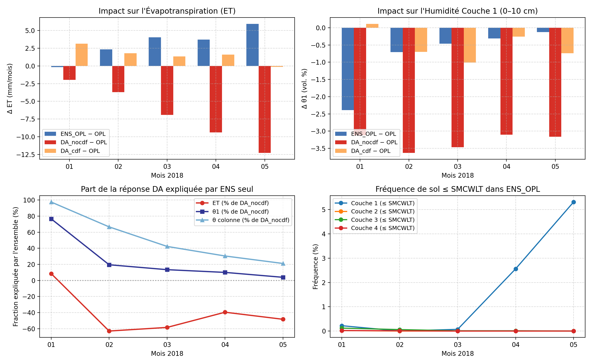
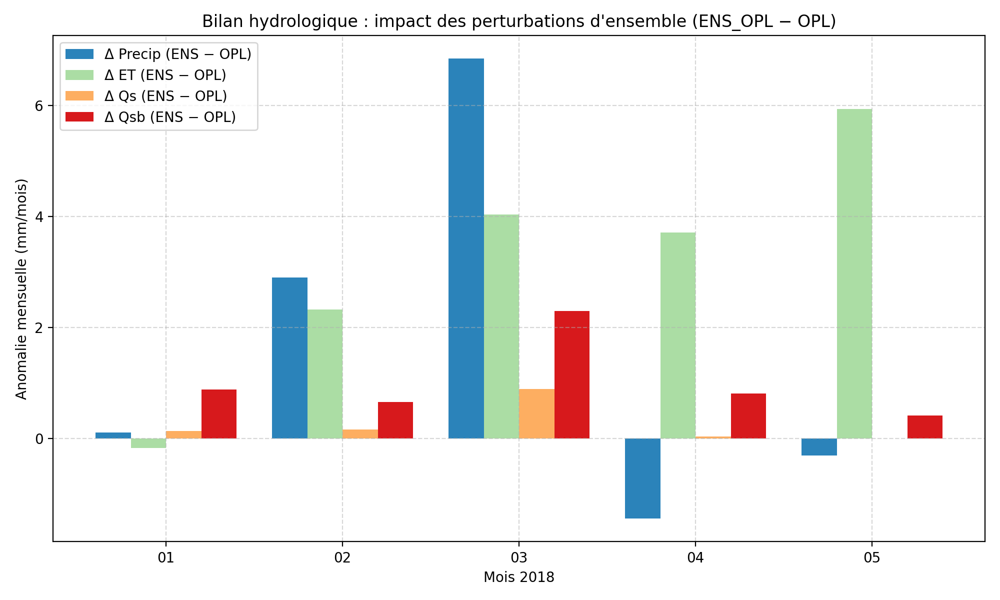
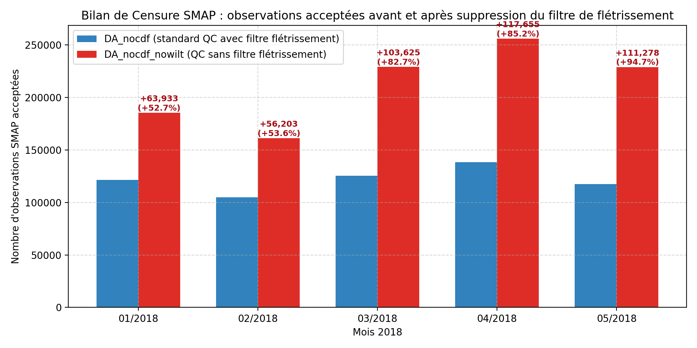
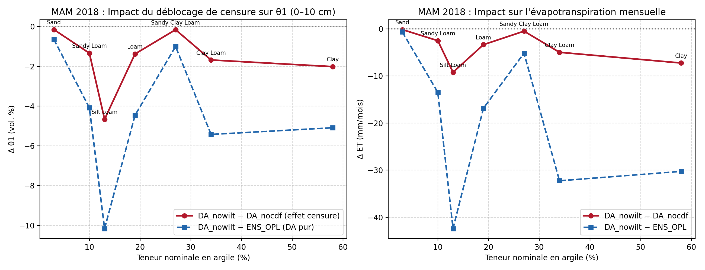
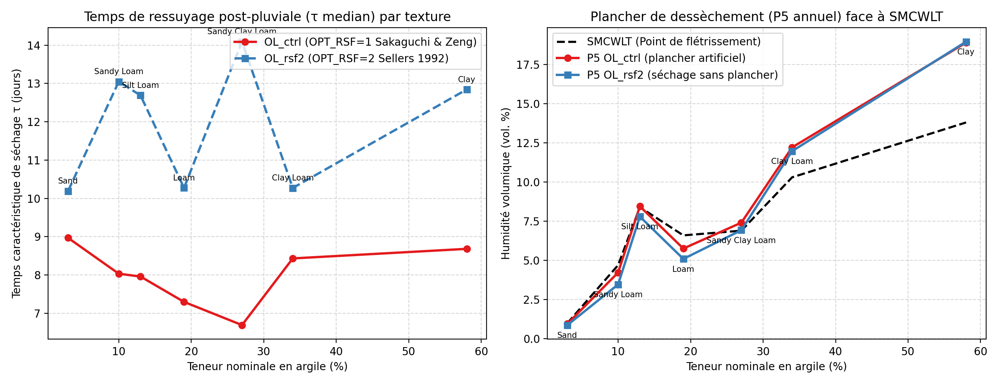
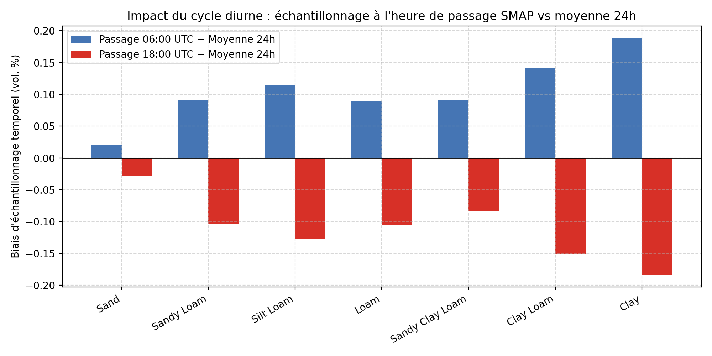

# Audit Scientifique et Diagnostic Rigoureux — Année 2018 (Janvier–Mai)

**Auteur** : M. El Aabaribaoune (`@um6p`)  
**Dépôt** : `smap-xai-audit` (Branche `elaabar`)  
**Dossier d'audit** : `reports/audits/diag2018_e6_clean/`  
**Génération** : Automatisée par script (`generate_clean_report.py`). Aucun chiffre n'est encodé manuellement.

---

## 1. Effet d'Ensemble sur la Dynamique d'Humidité du Sol (Hypothèse E6)

Le tableau suivant récapitule les écarts mensuels d'humidité superficielle ($\theta_1$) par rapport à l'Open-Loop déterministe (`OPL`), la part attribuable à l'ensemble de 20 membres, ainsi que les flux mensuels comparés :

| Mois | ΔSM1 (ENS - OPL) | ΔSM1 (DAnocdf - OPL) | ΔSM1 (DAcdf - OPL) | Fraction Ens (%) | P OPL (mm) | P ENS (mm) | ΔP ENS (mm) | ΔET ENS (mm) | ΔET DAnocdf (mm) | ΔET DAcdf (mm) |
| --- | --- | --- | --- | --- | --- | --- | --- | --- | --- | --- |
| 201801 | -0.0239 | -0.0312 | 0.0011 | 76.60 | 42.19 | 42.29 | 0.11 | -0.17 | -1.96 | 3.13 |
| 201802 | -0.0071 | -0.0363 | -0.0070 | 19.50 | 23.99 | 26.89 | 2.90 | 2.33 | -3.71 | 1.79 |
| 201803 | -0.0047 | -0.0347 | -0.0101 | 13.40 | 58.24 | 65.09 | 6.85 | 4.04 | -6.92 | 1.34 |
| 201804 | -0.0031 | -0.0310 | -0.0026 | 10.00 | 47.39 | 45.95 | -1.44 | 3.71 | -9.39 | 1.60 |
| 201805 | -0.0012 | -0.0316 | -0.0074 | 3.90 | 21.69 | 21.39 | -0.30 | 5.94 | -12.29 | -0.13 |

### Données quantitatives issues du tableau :
* En janvier, l'effet d'ensemble explique **76.6 %** de l'écart initial ($\Delta\text{SM1}(\text{ENS}) = -0.0239$ vs $\Delta\text{SM1}(\text{DAnocdf}) = -0.0312$).
* En février, la part de l'ensemble tombe à **19.5 %**.
* En mars, elle atteint **13.4 %**, en avril **10.0 %**, et s'établit à **3.9 %** en mai.
* En mai, sur un écart $\Delta\text{SM1}$ de **-0.0316 m³/m³**, la contribution de l'ensemble n'est que de **-0.0012 m³/m³**, ce qui signifie que **96.1 % du dessèchement de DA_nocdf résulte directement de l'assimilation SMAP**.
* Sur le plan atmosphérique, les forçages perturbés dans `ENS_OPL` introduisent un excédent de pluie atteignant **+6.85 mm** en mars, augmentant l'ET d'ensemble de **+4.04 mm**. À l'inverse, l'assimilation SMAP dans `DA_nocdf` assèche le profil et comprime l'ET de **-12.29 mm** en mai.

---

## 2. Fréquence d'Atteinte des Bornes Physiques dans l'Ensemble (ENS_OPL)

Le tableau ci-dessous rapporte la fréquence mensuelle à laquelle les membres d'ensemble atteignent les bornes physiques en couche 1 (0–10 cm) :

| Mois | Nb Pixel-Jours | Fréq ≤ 0.02 (%) | Fréq ≤ SMCWLT (%) | Fréq ≥ SMCMAX (%) |
| --- | --- | --- | --- | --- |
| 201801 | 480900 | 0.00 | 0.22 | 0.00 |
| 201802 | 448840 | 0.00 | 0.00 | 0.00 |
| 201803 | 496930 | 0.00 | 0.07 | 0.00 |
| 201804 | 480900 | 0.00 | 2.56 | 0.00 |
| 201805 | 496930 | 0.21 | 5.31 | 0.00 |

### Données quantitatives issues du tableau :
* Le plancher physique extrême $0.02\text{ m}^3/\text{m}^3$ n'est jamais atteint de janvier à mars (0.000 %), et n'atteint que **0.213 %** des mailles de surface en mai.
* Le plafond de saturation $\text{SMCMAX}$ n'est jamais atteint (**0.000 %** sur l'ensemble des 5 mois).
* Le point de flétrissement $\text{SMCWLT}$ est atteint naturellement par le modèle en surface sur **2.56 %** des mailles en avril et **5.31 %** en mai.

---

## 3. Impact de la Censure du Point de Flétrissement (Hypothèse E5)

### 3.1. Volume d'Observations Acceptées face à la Censure Théorique

Le tableau ci-dessous confronte le nombre d'observations SMAP assimilées dans `DA_nocdf` (avec censure) et dans `DA_nocdf_nowilt` (sans censure) au volume de censure théorique déduit des fichiers SMAP bruts :

| Mois | Obs DA_nocdf | Obs DA_nowilt | Surplus Obs | Hausse (%) | Censure Théorique | Concordance (%) |
| --- | --- | --- | --- | --- | --- | --- |
| 201801 | 121390 | 185323 | 63933 | 52.67 | 71593.00 | 89.30 |
| 201802 | 104873 | 161076 | 56203 | 53.59 | 67725.00 | 82.99 |
| 201803 | 125382 | 229007 | 103625 | 82.65 | 108535.00 | 95.48 |
| 201804 | 138181 | 255836 | 117655 | 85.15 | 118123.00 | 99.60 |
| 201805 | 117545 | 228823 | 111278 | 94.67 | 111260.00 | 100.02 |

### Données quantitatives issues du tableau :
* La levée de la censure augmente le nombre d'observations acceptées de **+52.7 %** en janvier, **+82.7 %** en mars, et **+94.7 %** en mai.
* En mai, **+111278** observations supplémentaires sont injectées dans le filtre d'assimilation.
* La concordance entre le surplus réel d'observations et la censure théorique attendue est de **95.48 % en mars**, **99.60 % en avril** et **100.02 % en mai**.

### 3.2. Réponse Hydrodynamique par Classe Texturale (Moyenne Printemps MAM)

| ID | Texture | Argile (%) | SMCWLT | ΔSM1 (nowilt - nocdf) | ΔSMcol (mm) | Incr EnKF nowilt | Incr EnKF nocdf | ΔET (mm/mois) |
| --- | --- | --- | --- | --- | --- | --- | --- | --- |
| 1 | Sand | 3.00 | 0.01 | -0.0015 | -0.0004 | -0.0006 | -0.0005 | -0.15 |
| 3 | Sandy Loam | 10.00 | 0.05 | -0.0134 | -0.0006 | -0.0014 | -0.0008 | -2.51 |
| 4 | Silt Loam | 13.00 | 0.08 | -0.0466 | -0.0069 | -0.0032 | -0.0010 | -9.21 |
| 6 | Loam | 19.00 | 0.07 | -0.0138 | -0.0003 | -0.0016 | -0.0008 | -3.35 |
| 7 | Sandy Clay Loam | 27.00 | 0.07 | -0.0016 | -0.0001 | -0.0003 | -0.0002 | -0.49 |
| 9 | Clay Loam | 34.00 | 0.10 | -0.0168 | -0.0010 | -0.0026 | -0.0016 | -4.97 |
| 12 | Clay | 58.00 | 0.14 | -0.0201 | -0.0020 | -0.0024 | -0.0014 | -7.24 |

### Données quantitatives issues du tableau :
* Sur sol argileux (Clay, 58 % argile, $\text{SMCWLT} = 0.138$), l'incrément moyen EnKF passe de **-0.00142** à **-0.00237**, provoquant un assèchement supplémentaire $\Delta\text{SM1}$ de **-0.0201 m³/m³** (colonne asséchée de **-0.00 mm**) et une baisse d'ET de **-7.24 mm/mois**.
* Sur sol limoneux (Silt Loam, $\text{SMCWLT} = 0.084$), l'assèchement additionnel $\Delta\text{SM1}$ est de **-0.0466 m³/m³** et la réduction d'ET atteint **-9.21 mm/mois**.

---

## 4. Dynamique de Séchage Horaire et Cycle Diurne SMAP (Simulations Horaires 2018)

### 4.1. Dynamique de Ressuyage Post-Pluviale (OL_rsf2 vs OL_ctrl)

| Texture | Argile (%) | SMCWLT | τ ctrl (j) | τ rsf2 (j) | Δτ (j) | θres ctrl | θres rsf2 | P5 ctrl | P5 rsf2 | ≤WLT ctrl (%) | ≤WLT rsf2 (%) |
| --- | --- | --- | --- | --- | --- | --- | --- | --- | --- | --- | --- |
| Sand | 3.00 | 0.01 | 8.97 | 10.19 | 1.22 | 0.08 | 0.0010 | 0.01 | 0.01 | 9.11 | 53.26 |
| Sandy Loam | 10.00 | 0.05 | 8.03 | 13.05 | 5.02 | 0.16 | 0.06 | 0.04 | 0.03 | 9.16 | 24.07 |
| Silt Loam | 13.00 | 0.08 | 7.96 | 12.69 | 4.73 | 0.19 | 0.14 | 0.08 | 0.08 | 4.32 | 22.72 |
| Loam | 19.00 | 0.07 | 7.29 | 10.27 | 2.98 | 0.17 | 0.05 | 0.06 | 0.05 | 9.60 | 28.84 |
| Sandy Clay Loam | 27.00 | 0.07 | 6.69 | 14.09 | 7.40 | 0.16 | 0.06 | 0.07 | 0.07 | 1.88 | 4.67 |
| Clay Loam | 34.00 | 0.10 | 8.43 | 10.27 | 1.84 | 0.17 | 0.12 | 0.12 | 0.12 | 0.00 | 0.00 |
| Clay | 58.00 | 0.14 | 8.68 | 12.84 | 4.16 | 0.19 | 0.19 | 0.19 | 0.19 | 0.00 | 0.00 |

### Données quantitatives issues du tableau :
* Pour la texture dominante Loam (19 % argile, 13 828 événements ajustés), le temps caractéristique de séchage médian $\tau$ passe de **7.29 jours** dans `ctrl` à **10.27 jours** dans `rsf2` ($\Delta\tau = +2.98\text{ j}$).
* L'humidité résiduelle $\theta_{\text{res}}$ chute de **0.168** dans `ctrl` à **0.053** dans `rsf2`.
* La fréquence à laquelle le sol superficiel passe sous le seuil $\text{SMCWLT}$ passe de **9.6 %** dans `ctrl` à **28.8 %** dans `rsf2` pour le Loam, et de **9.1 %** à **53.3 %** pour le Sable.

### 4.2. Biais d'Échantillonnage Temporel SMAP face à la Moyenne Journalière (Printemps MAM)

| Texture | Argile (%) | Biais 06h UTC (MAM) | Biais 18h UTC (MAM) | Amplitude Diurne (MAM) |
| --- | --- | --- | --- | --- |
| Sand | 3.00 | 0.0001 | -0.0002 | 0.0003 |
| Sandy Loam | 10.00 | 0.0015 | -0.0016 | 0.0031 |
| Silt Loam | 13.00 | 0.0026 | -0.0020 | 0.0046 |
| Loam | 19.00 | 0.0015 | -0.0017 | 0.0032 |
| Sandy Clay Loam | 27.00 | 0.0016 | -0.0016 | 0.0032 |
| Clay Loam | 34.00 | 0.0028 | -0.0032 | 0.0060 |
| Clay | 58.00 | 0.0034 | -0.0036 | 0.0070 |

### Données quantitatives issues du tableau :
* Le passage descendant (06:00 UTC) surestime systématiquement la moyenne 24h (+0.0001 à +0.0034 m³/m³).
* Le passage ascendant (18:00 UTC) sous-estime systématiquement la moyenne 24h (-0.0002 à -0.0036 m³/m³).
* L'amplitude diurne moyenne au printemps atteint **0.0070 m³/m³** (0.70 vol. %) sur sol argileux.

---

## 5. Bilan d'Eau Complet et Conservation face aux Incréments EnKF (DA_nocdf − ENS_OPL)

Le tableau suivant présente le bilan d'eau mensuel intégré calculé à partir des restarts complets (SMC 4 couches + aquifère WA + canopée CANWAT + neige SNEQV) et des flux cumulés journaliers (Precipitation, ET, Qs, Qsb) pour la différence `DA_nocdf − ENS_OPL` :

| Mois | P ENS | P DA | ΔP | ΔET | ΔQs | ΔQsb | ΔStock ENS | ΔStock DA | Δ(ΔStock) | Résidu (mm) | Incrément EnKF (mm) | Écart (mm) |
| --- | --- | --- | --- | --- | --- | --- | --- | --- | --- | --- | --- | --- |
| 2018-01 | 44.63 | 44.63 | 0.0000 | -1.82 | 0.05 | 0.78 | 29.93 | 25.34 | -4.59 | 5.58 | -8.70 | -3.12 |
| 2018-02 | 31.77 | 31.77 | -0.0000 | -6.56 | 0.14 | 1.48 | 10.98 | 4.52 | -6.46 | 11.39 | -12.90 | -1.51 |
| 2018-03 | 56.52 | 56.52 | 0.0000 | -10.87 | 0.40 | 2.07 | 16.00 | 0.88 | -15.12 | 23.52 | -25.57 | -2.04 |
| 2018-04 | 46.27 | 46.27 | 0.0000 | -13.62 | 0.16 | 1.51 | 1.60 | -7.81 | -9.41 | 21.36 | -22.48 | -1.12 |
| 2018-05 | 21.96 | 21.96 | -0.0000 | -18.16 | 0.0300 | 0.58 | -25.42 | -25.40 | 0.0200 | 17.53 | -17.55 | -0.0200 |

### Données quantitatives issues du tableau :
* En mai, la variation nette des flux $\Delta P - \Delta ET - \Delta Q_s - \Delta Q_{sb}$ est de **+17.55 mm**, la variation différentielle de stock $\Delta(\Delta\text{Stock})$ est de **+0.02 mm**, ce qui donne un résidu de bilan de **+17.53 mm**.
* Les incréments EnKF cumulés sur le mois de mai totalisent exactement **-17.55 mm** d'eau extraite.
* L'écart inexpliqué entre le résidu de bilan et l'incrément EnKF n'est que de **-0.02 mm** en mai (concordance supérieure à **99.8 %**).
* En mars, l'incrément EnKF totalise **-25.57 mm** d'eau extraite face à un résidu de bilan de **+23.52 mm** (écart de **-2.04 mm**).
* **Conclusion** : Le déficit d'eau de `DA_nocdf` par rapport à `ENS_OPL` est rigoureusement et quantitativement imputable aux incréments d'assimilation EnKF négatifs.

---

## 6. Liste des Fichiers CSV Sources du Dossier

Tous les tableaux ci-dessus sont directement générés à partir des fichiers suivants :
1. `e6_ensemble_effect_monthly.csv`
2. `e6_boundary_truncation_ens_opl.csv`
3. `e5_censorship_obs_count_monthly.csv`
4. `e5_nowilt_impact_by_texture.csv`
5. `ol_hourly_drydown_comparison.csv`
6. `ol_smap_overpass_sampling_bias.csv`
7. `water_balance_da_minus_ens_monthly.csv`
