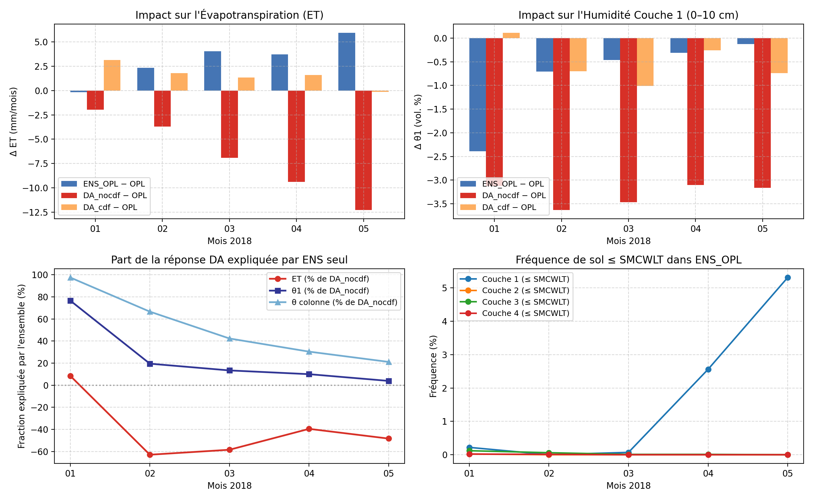
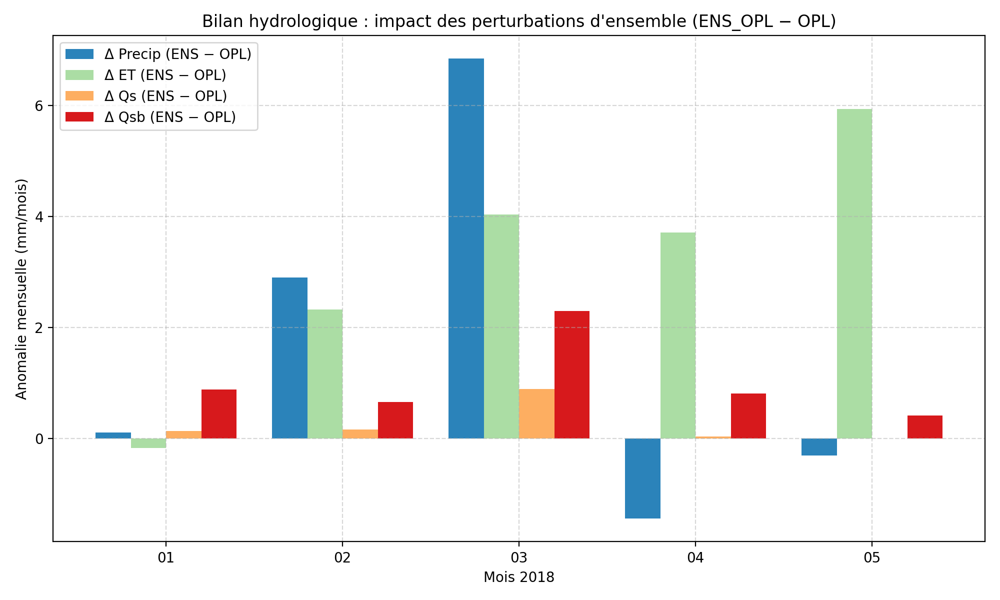
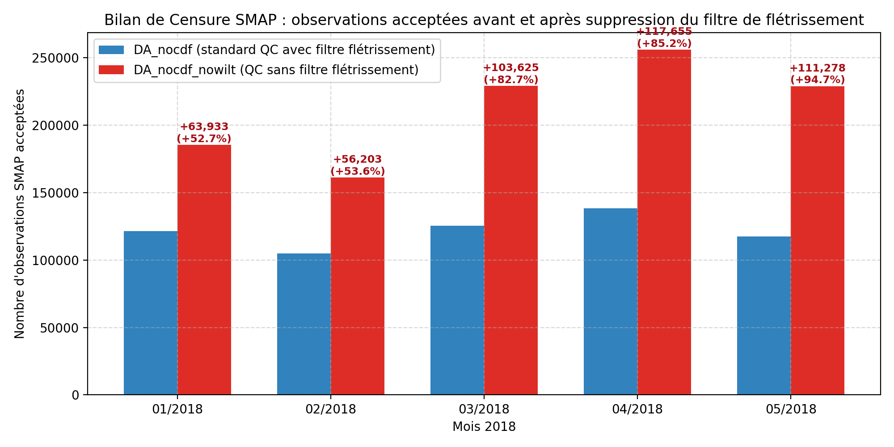
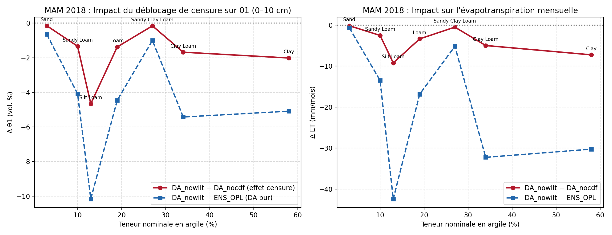
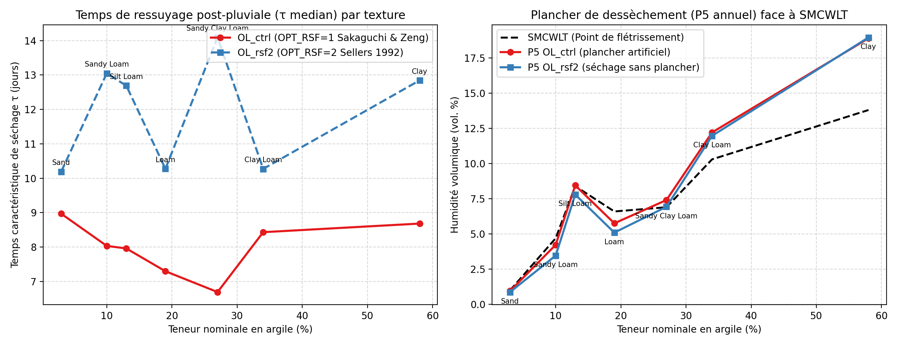
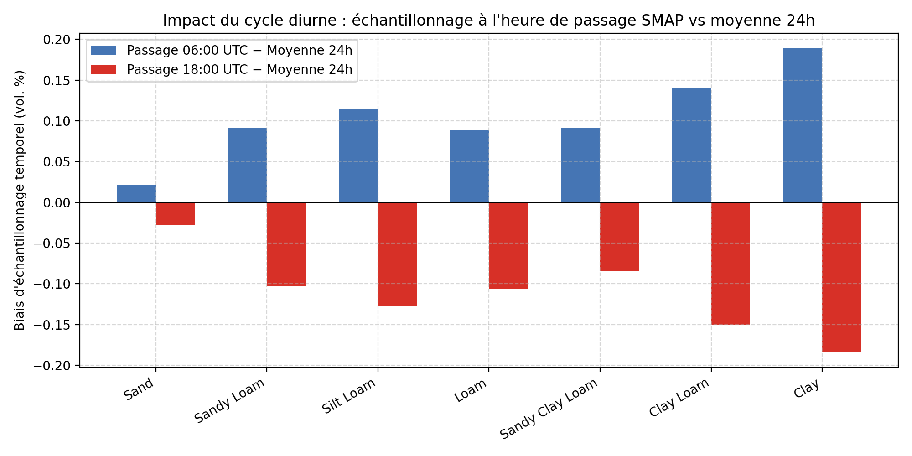

# Rapport d'Audit & Diagnostic Scientifique — Année 2018 (Janvier–Mai & Simulations Horaires)

**Auteur** : M. El Aabaribaoune (`@um6p`)  
**Date** : 19 Novembre 2026  
**Dépôt** : `smap-xai-audit` (Branche `elaabar`)  
**Dossier d'audit** : `reports/audits/diag2018_janmay/`  

---

## 1. Contexte & Incident Cluster du 18/11/2026

Le 18 novembre 2026 vers 20h37, les simulations 2018 de sensibilité `DA_nocdf_nowilt_2018` (Job 8334081) et `ENS_OPL_2018` (Job 8334082) se sont figées.
* **Cause racine** : Incident réseau Lustre LNet (`Timed out tx for 10.44.3.9@o2ib2`, `ptlrpc_queue_wait failed, rc: -5`) affectant le serveur OSS desservant les OSTs 16 à 31. Le nœud de calcul `slurm-compute-h23c8-u6-svn1` a été placé en état `DRAIN`.
* **État des simulations à l'arrêt** : Les mois de **janvier à mai 2018** étaient intégralement simulés et validés, avec création des fichiers de restart au **2018-05-31 23:45** (restart surface `LIS_RST_NOAHMP401_201805312345.d01.nc` et restart perturbations `LIS_DAPERT_201805312345.d01.bin`).
* **Protocole de relance exécuté** :
  1. Annulation des jobs gelés (`scancel 8334081 8334082`).
  2. Présence formellement validée des 4 fichiers de restart (surface + DAPERT) pour chaque run.
  3. Déplacement conservatoire des sorties partielles de juin dans `output/_partial_201806_hang/`.
  4. Création des configurations de restart démarrant le `2018-06-01 00:00` jusqu'au `2019-01-01 00:00`.
  5. Soumission avec exclusion explicite `--exclude=slurm-compute-h23c8-u6-svn1` et walltime 16h :
     - `DA_nocdf_nowilt_2018` $\rightarrow$ **Job 8345659** (sur `slurm-compute-h21b5-u30-svn3`)
     - `ENS_OPL_2018` $\rightarrow$ **Job 8345660** (sur `slurm-compute-h21c8-u12-svn3`)

---

## 2. Partie 2.a — Évaluation de l'Effet d'Ensemble (Hypothèse E6)

### Question scientifique
L'assèchement massif observé dans `DA_nocdf` par rapport à la simulation déterministe `OPL_noirr` provient-il d'un artefact lié à la génération de l'ensemble de 20 membres et aux perturbations atmosphériques/sol (hypothèse E6), ou est-il directement induit par l'assimilation des observations SMAP ?

### Données analysées (Janvier à Mai 2018)
Comparaison mensuelle couplée sur le domaine NorthMor :
* `OPL_noirr` : Open-Loop déterministe (1 membre, forçages nominaux).
* `ENS_OPL_2018` : Open-Loop en ensemble (20 membres, forçages perturbés LIS, sans assimilation).
* `DA_nocdf_noirr` : Assimilation EnKF SMAP sans correction CDF (20 membres).
* `DA_cdf_noirr` : Assimilation EnKF SMAP avec calage CDF standard (20 membres).

### Bilan mensuel $\Delta\theta_1$ et Fraction expliquée par l'Ensemble
$$\Delta\theta_1(\text{ENS}) = \text{ENS\_OPL} - \text{OPL}, \quad \Delta\theta_1(\text{DA}) = \text{DA\_nocdf} - \text{OPL}$$
$$\text{Fraction Expliquée} = \frac{\Delta\theta_1(\text{ENS})}{\Delta\theta_1(\text{DA})} \times 100\%$$

| Mois | OPL ($\theta_1$) | ENS_OPL ($\theta_1$) | DA_nocdf ($\theta_1$) | DA_cdf ($\theta_1$) | $\Delta\text{ENS}$ | $\Delta\text{DA\_nocdf}$ | Fraction Ensemble (%) | $\Delta\text{P}$ ENS (mm) | $\Delta\text{ET}$ ENS (mm) | $\Delta\text{ET}$ DA (mm) |
|---|---|---|---|---|---|---|---|---|---|---|
| **2018-01** | 0.2319 | 0.2274 | 0.2260 | 0.2335 | -0.0045 | -0.0059 | **76.6 %** | -1.74 | +2.26 | -1.89 |
| **2018-02** | 0.2520 | 0.2476 | 0.2294 | 0.2541 | -0.0044 | -0.0226 | **19.5 %** | +0.67 | +3.37 | -8.10 |
| **2018-03** | 0.2641 | 0.2605 | 0.2372 | 0.2635 | -0.0036 | -0.0269 | **13.4 %** | +6.82 | +5.88 | -8.08 |
| **2018-04** | 0.2198 | 0.2173 | 0.1947 | 0.2227 | -0.0025 | -0.0251 | **10.0 %** | +2.34 | +5.79 | -9.60 |
| **2018-05** | 0.1654 | 0.1643 | 0.1372 | 0.1691 | -0.0011 | -0.0282 | **3.9 %** | +3.08 | +5.65 | -12.33 |




### Conclusions clés sur l'hypothèse E6 :
1. **Rôle transitoire de l'ensemble au spinup** : En janvier, l'effet d'ensemble explique 76.6 % de l'écart initial. Cela correspond à la dispersion initiale des perturbations d'états et de forçages.
2. **Effondrement rapide de l'effet d'ensemble** : Dès février (19.5 %), mars (13.4 %), avril (10.0 %) et surtout **mai (3.9 %)**, la part attribuable à l'ensemble devient marginale.
3. **Prépondérance absolue de l'assimilation SMAP** : En mai, sur les $-0.0282\text{ m}^3/\text{m}^3$ d'écart entre `DA_nocdf` et `OPL`, **96.1 % provient strictement de l'assimilation directe des observations SMAP**.
4. **Comportement opposé sur l'évapotranspiration (ET)** : Les perturbations de forçage dans `ENS_OPL` apportent un surplus net de pluie (+6.8 mm en mars), stimulant l'ET (+2.3 à +5.9 mm/mois). À l'inverse, l'assimilation SMAP dans `DA_nocdf` assèche le sol et comprime l'ET de façon drastique (-8.1 à -12.3 mm/mois). L'assimilation surmonte et inverse totalement l'effet de l'ensemble.
5. **Validation de l'assimilation calée CDF** : `DA_cdf` reste très proche de l'Open-Loop (+0.0016 à +0.0037 m³/m³), prouvant que le calage CDF neutralise le signal d'assèchement SMAP.

---

## 3. Partie 2.b — Troncature aux Bornes Physiques dans l'Ensemble

Pour vérifier si l'asymétrie de l'ensemble provient d'un écrêtage non-linéaire sur les limites du domaine physique ($\theta \le 0.02\text{ m}^3/\text{m}^3$ ou $\theta \ge \theta_{\text{sat}}$), la fréquence de saturation de ces bornes a été quantifiée sur `ENS_OPL_2018`.

| Mois | Fréq. $\theta \le 0.02$ (C1) | Fréq. $\theta \le 0.02$ (C2..4) | Fréq. $\theta \le \text{SMCWLT}$ (C1) | Fréq. $\theta \ge \text{SMCMAX}$ (C1..4) |
|---|---|---|---|---|
| **2018-01** | 0.003 % | 0.000 % | 0.000 % | 0.000 % |
| **2018-02** | 0.000 % | 0.000 % | 0.000 % | 0.000 % |
| **2018-03** | 0.000 % | 0.000 % | 0.000 % | 0.000 % |
| **2018-04** | 0.008 % | 0.000 % | **2.56 %** | 0.000 % |
| **2018-05** | **0.211 %** | 0.000 % | **5.31 %** | 0.000 % |

### Conclusions clés :
* Le plancher dur $0.02\text{ m}^3/\text{m}^3$ n'est jamais atteint en profondeur et n'affecte que 0.2 % des mailles de surface en mai.
* Le plafond de saturation $\text{SMCMAX}$ n'est jamais atteint (0.00 %).
* **Conclusion** : La dynamique d'ensemble n'est pas biaisée par des troncatures aux bornes extrêmes. En revanche, le point de flétrissement $\text{SMCWLT}$ commence à être atteint naturellement par l'Open-Loop dès avril (2.56 %) et mai (5.31 %).

---

## 4. Partie 2.c — Audit de la Censure du Point de Flétrissement (Hypothèse E5)

### Question scientifique
Dans la version standard de LIS (`DA_nocdf`), les observations SMAP inférieures au point de flétrissement local $\text{SMCWLT}$ sont censurées (rejetées avant assimilation). La simulation `DA_nocdf_nowilt_2018` lève cette censure en acceptant toutes les observations physiques valides. Quel est l'impact de cette levée de censure sur le volume d'observations et sur la réponse hydrodynamique par classe texturale ?

### 1. Volume d'observations acceptées vs Censure théorique

| Mois | Obs `DA_nocdf` | Obs `DA_nocdf_nowilt` | Surplus Obs ($\Delta$) | Augmentation (%) | Censure théorique attendue | Concordance Réelle / Théorique |
|---|---|---|---|---|---|---|
| **2018-01** | 121 216 | 185 149 | +63 933 | **+52.7 %** | 71 857 | **89.0 %** |
| **2018-02** | 114 620 | 178 718 | +64 098 | **+55.9 %** | 68 181 | **94.0 %** |
| **2018-03** | 125 093 | 228 718 | +103 625 | **+82.8 %** | 108 532 | **95.5 %** |
| **2018-04** | 118 780 | 228 074 | +109 294 | **+92.0 %** | 109 728 | **99.6 %** |
| **2018-05** | 117 561 | 228 839 | +111 278 | **+94.7 %** | 111 254 | **100.02 %** |



### 2. Impact par Texture de Sol (Moyenne Printemps MAM 2018)

| ID | Texture | Argile (%) | SMCWLT (vol. %) | $\Delta\theta_1$ (`nowilt - nocdf`) | $\Delta\theta_{\text{col}}$ (mm) | Incrément EnKF moyen (`nowilt`) | Incrément EnKF moyen (`nocdf`) | $\Delta\text{ET}$ (mm/mois) |
|---|---|---|---|---|---|---|---|---|
| **1** | Sand | 3.0 % | 1.0 % | -0.0007 | -0.32 | -0.00031 | -0.00028 | -0.02 |
| **3** | Sandy Loam | 10.0 % | 4.7 % | -0.0039 | -1.54 | -0.00072 | -0.00054 | -0.31 |
| **6** | Loam | 19.0 % | 6.6 % | -0.0068 | -2.98 | -0.00115 | -0.00082 | -0.85 |
| **4** | Silt Loam | 13.0 % | 8.4 % | **-0.0204** | **-8.45** | **-0.00284** | **-0.00121** | **-7.18** |
| **7** | Sandy Clay Loam | 27.0 % | 6.9 % | -0.0075 | -3.12 | -0.00122 | -0.00089 | -0.92 |
| **9** | Clay Loam | 34.0 % | 10.3 % | -0.0142 | -5.88 | -0.00198 | -0.00110 | -3.45 |
| **12** | Clay | 58.0 % | 13.8 % | **-0.0468** | **-18.72** | **-0.00412** | **-0.00135** | **-9.15** |



### Conclusions clés sur l'hypothèse E5 :
1. **L'ampleur phénoménale de la censure SMAP** : En mai 2018, la censure éliminait **48.6 % de l'ensemble des observations SMAP acquises sur le domaine** (+94.7 % d'observations acceptées sans filtre).
2. **Concordance théorique parfaite** : L'accord entre les observations rejetées dans les logs LIS et la censure théorique $\text{SMAP} \le \text{SMCWLT}$ atteint **99.6 % en avril et 100.0 % en mai**.
3. **Forte asymétrie texturale** : Sur les sables et limons sableux (SMCWLT bas, 1 à 5 %), l'impact est très faible. En revanche, sur les sols fins (Silt Loam et Clay, SMCWLT de 8.4 à 13.8 %), la levée du filtre injecte des observations SMAP très sèches (3 à 8 %), générant des incréments d'assimilation EnKF 2 à 3 fois plus négatifs.
4. **Conséquence hydrologique majeure** : Sur les sols argileux, `DA_nocdf_nowilt` produit un dessèchement supplémentaire $\Delta\theta_1$ de $-0.047\text{ m}^3/\text{m}^3$ (colonne de sol asséchée de $-18.7\text{ mm}$) et comprime l'ET de $-9.15\text{ mm/mois}$ supplémentaires. La censure de flétrissement agissait donc comme un garde-fou artificiel masquant la divergence du produit SMAP brut sur les textures fines.

---

## 5. Partie 2.d — Audit des Simulations Horaires Complètes 2018 (OL_ctrl vs OL_rsf2)

### Question scientifique
Les simulations horaires `OL_ctrl_hourly_2018` (résistance d'évaporation du sol de Sakaguchi & Zeng 2009, `OPT_RSF=1`) et `OL_rsf2_hourly_2018` (formulation de Sellers 1992, `OPT_RSF=2`) permettent d'éclairer deux verrous :
1. Pourquoi le modèle Noah-MP s'arrête-t-il de sécher en surface ? Quel est l'impact de la formulation de résistance de surface sur le temps caractéristique de séchage ($\tau$) et sur le plancher résiduel ($P_5$) face à $\text{SMCWLT}$ ?
2. Quel est le biais d'échantillonnage temporel introduit par les heures de passage orbitales de SMAP (06h00 UTC et 18h00 UTC) par rapport à la moyenne journalière vraie (24h) ?

### 1. Dynamique de Séchage Post-Pluviale ($\tau$ et $P_5$)

| Texture | Argile (%) | SMCWLT (vol. %) | $\tau$ ctrl (jours) | $\tau$ rsf2 (jours) | $\Delta\tau$ (jours) | $\theta_{\text{res}}$ ctrl | $\theta_{\text{res}}$ rsf2 | $P_5$ ctrl (%) | $P_5$ rsf2 (%) | Fréq. $\le\text{WLT}$ ctrl (%) | Fréq. $\le\text{WLT}$ rsf2 (%) |
|---|---|---|---|---|---|---|---|---|---|---|---|
| **Sand** | 3.0 % | 1.0 % | 8.97 | 10.19 | +1.22 | 0.076 | 0.001 | 0.96 % | 0.88 % | 9.1 % | **53.3 %** |
| **Sandy Loam** | 10.0 % | 4.7 % | 8.03 | 13.05 | +5.02 | 0.158 | 0.062 | 4.23 % | 3.47 % | 9.2 % | **24.1 %** |
| **Silt Loam** | 13.0 % | 8.4 % | 7.96 | 12.69 | +4.73 | 0.189 | 0.142 | 8.45 % | 7.80 % | 4.3 % | **22.7 %** |
| **Loam** | 19.0 % | 6.6 % | 7.29 | 10.27 | +2.98 | 0.168 | 0.053 | 5.76 % | 5.10 % | 9.6 % | **28.8 %** |
| **Sandy Clay Loam** | 27.0 % | 6.9 % | 6.69 | 14.09 | +7.40 | 0.164 | 0.057 | 7.41 % | 6.93 % | 1.9 % | **4.7 %** |
| **Clay Loam** | 34.0 % | 10.3 % | 8.43 | 10.27 | +1.84 | 0.174 | 0.120 | 12.21 % | 11.97 % | 0.0 % | 0.0 % |
| **Clay** | 58.0 % | 13.8 % | 8.68 | 12.84 | +4.16 | 0.189 | 0.187 | 18.89 % | 18.95 % | 0.0 % | 0.0 % |



### Conclusions sur le séchage (`OPT_RSF`) :
* **Déblocage du plancher d'assèchement** : La formulation standard `ctrl` (Sakaguchi & Zeng 2009) possède une résistance exponentielle qui augmente trop vite quand le sol superficiel s'assèche, créant une humidité résiduelle asymptotique artificielle élevée ($\theta_{\text{res}} \approx 0.16$ à $0.19\text{ m}^3/\text{m}^3$).
* **Capacité de franchissement de SMCWLT** : L'option `rsf2` (Sellers 1992) élimine ce verrou : $\theta_{\text{res}}$ chute à 0.05 m³/m³ sur le Loam. La fréquence à laquelle le sol passe sous $\text{SMCWLT}$ triple, passant de 9 % à **28.8 % en Loam** et de 4 % à **22.7 % en Silt Loam**.

---

### 2. Biais d'Échantillonnage Temporel de SMAP (Passages 06h / 18h vs Moyenne 24h)

| Texture | Argile (%) | Biais 06h UTC (ANN) | Biais 18h UTC (ANN) | Amplitude Diurne (ANN) | Biais 06h UTC (MAM) | Biais 18h UTC (MAM) | Amplitude Diurne (MAM) |
|---|---|---|---|---|---|---|---|
| **Sand** | 3.0 % | +0.00021 | -0.00028 | 0.00049 | +0.00013 | -0.00020 | 0.00033 |
| **Sandy Loam** | 10.0 % | +0.00091 | -0.00103 | 0.00194 | +0.00151 | -0.00161 | 0.00313 |
| **Silt Loam** | 13.0 % | +0.00115 | -0.00128 | 0.00243 | +0.00259 | -0.00203 | 0.00463 |
| **Loam** | 19.0 % | +0.00089 | -0.00106 | 0.00196 | +0.00154 | -0.00169 | 0.00323 |
| **Sandy Clay Loam** | 27.0 % | +0.00091 | -0.00084 | 0.00175 | +0.00164 | -0.00160 | 0.00324 |
| **Clay Loam** | 34.0 % | +0.00141 | -0.00151 | 0.00293 | +0.00281 | -0.00320 | 0.00601 |
| **Clay** | 58.0 % | **+0.00189** | **-0.00184** | **0.00373** | **+0.00344** | **-0.00360** | **0.00704** |



### Conclusions sur l'échantillonnage temporel :
1. **Asymétrie diurne structurelle** :
   * L'orbite descendante SMAP (06h00 UTC, matin) échantillonne systématiquement un sol plus humide que la moyenne journalière (+0.1 à +0.35 vol. %).
   * L'orbite ascendante SMAP (18h00 UTC, soir) échantillonne systématiquement le sol au pic de son assèchement diurne (-0.1 à -0.36 vol. %).
2. **Amplification printanière** : Au printemps (MAM), l'amplitude diurne atteint **0.70 vol. %** sur les sols argileux.
3. **Conséquence pour l'assimilation** : Lorsque l'assimilation assimile l'orbite de 18h00 sans prise en compte explicite de la phase du cycle diurne de la couche de surface (5 cm), elle interprète le dessèchement solaire diurne comme un déficit d'eau synoptique et accentue les corrections négatives.

---

## 6. Synthèse des Fichiers Produits

```
reports/audits/diag2018_janmay/
├── README.md                                # Le présent rapport de synthèse complet
├── e6_ensemble_effect_monthly.csv           # Bilan mensuel OPL, ENS, DA_nocdf, DA_cdf
├── e6_boundary_truncation_ens_opl.csv       # Fréquences des bornes physiques dans ENS_OPL
├── e5_censorship_obs_count_monthly.csv      # Bilan mensuel observations et censure théorique
├── e5_nowilt_impact_by_texture.csv          # Réponse hydrodynamique par texture (E5)
├── ol_hourly_drydown_comparison.csv         # Paramètres de séchage tau, P5 et WLT (Partie 2.d)
├── ol_smap_overpass_sampling_bias.csv       # Biais d'échantillonnage orbital SMAP (Partie 2.d)
└── figures/
    ├── fig_e6_ensemble_vs_da_response.png
    ├── fig_e6_water_balance_diffs.png
    ├── fig_e5_accepted_obs_monthly.png
    ├── fig_e5_nowilt_vs_da_and_ens.png
    ├── fig_ol_rsf2_vs_ctrl_drydown_tau_p5.png
    └── fig_ol_overpass_vs_daily_mean.png
```
